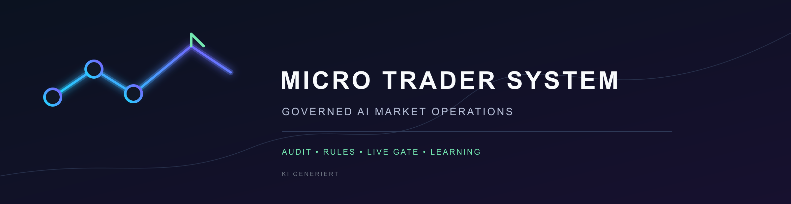
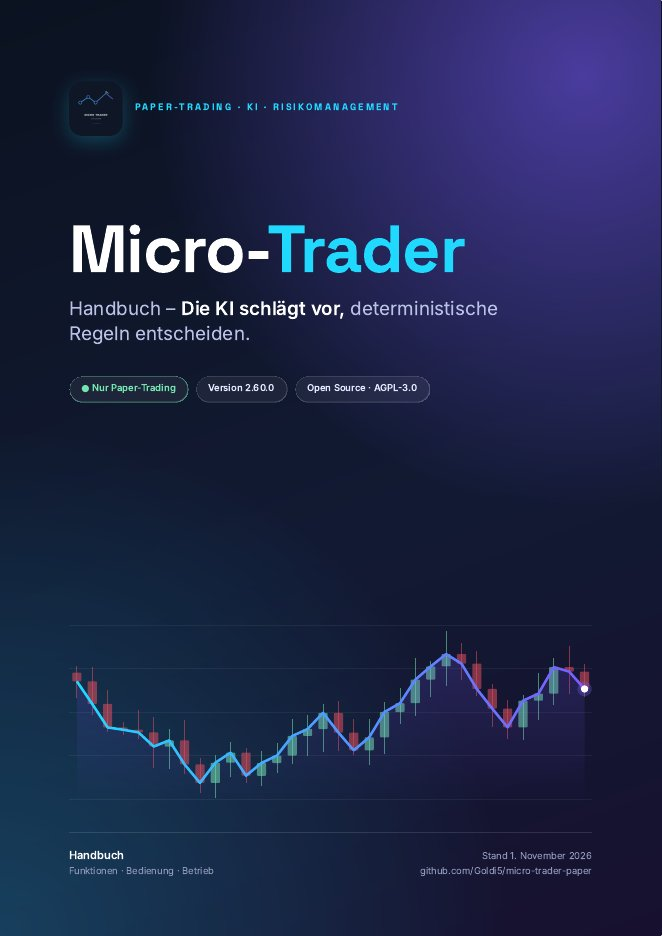
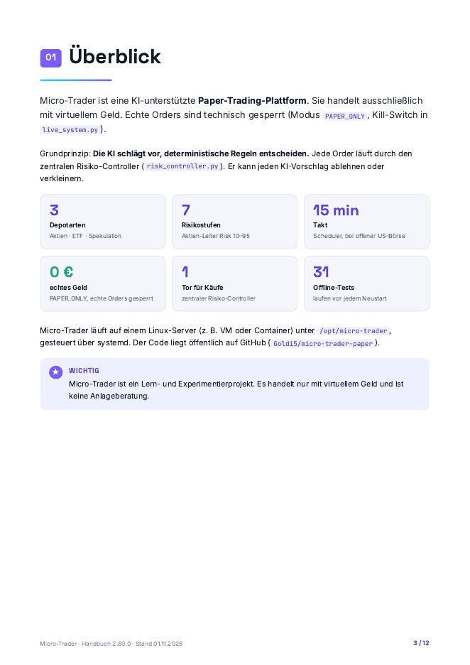
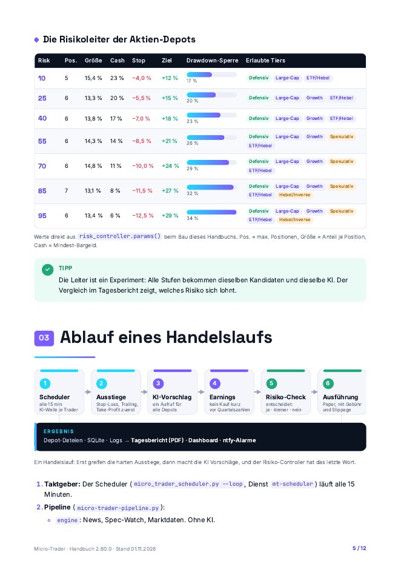
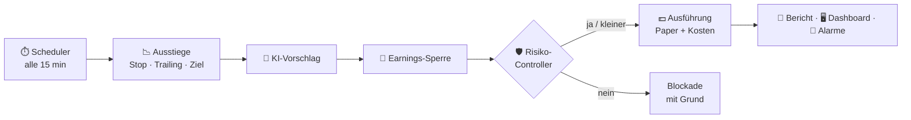

<p align="center"></p>

# Micro-Trader

**KI-unterstützte Paper-Trading-Plattform mit deterministischem Risikomanagement.**
Die KI schlägt vor, feste Regeln entscheiden, was tatsächlich gehandelt wird. Gehandelt wird ausschließlich mit virtuellem Geld.

[](../../actions/workflows/tests.yml)
[](../../actions/workflows/handbuch.yml)


> 📘 **Handbuch als PDF**: Funktionen, Bedienung, Betrieb, mit Grafiken und Risikoleiter.
> [**Herunterladen**](../../releases/latest/download/Micro-Trader-Handbuch.pdf) · [im Browser lesen](docs/handbuch/HANDBUCH.md)

> [!WARNING]
> **Keine Anlageberatung.** Privates Lern- und Experimentierprojekt mit virtuellem Geld, ohne Gewährleistung. Details: [`RECHTLICHES.md`](RECHTLICHES.md).

<p align="center">
<a href="../../releases/latest/download/Micro-Trader-Handbuch.pdf"></a>
<a href="../../releases/latest/download/Micro-Trader-Handbuch.pdf"></a>
<a href="../../releases/latest/download/Micro-Trader-Handbuch.pdf"></a>
</p>

## Funktionen

| | |
|---|---|
| 🧪 **Nur Paper-Trading** | Echte Orders sind technisch gesperrt (`PAPER_ONLY`, Kill-Switch). |
| 🪜 **Risikoleiter** | 7 Aktien-Depots von Risk 10 bis 95 mit denselben Kandidaten. So zeigt sich, welches Risiko sich lohnt. Dazu 10 ETF-Testdepots und je ein Depot pro Spekulationswert. |
| 🤖 **KI mit Anbieter-Rotation** | Mehrere Free-Tier-Anbieter im Wechsel, Cooldown bei Fehlern, jeder Aufruf wird protokolliert. |
| 🛡️ **Risiko-Controller** | Einziges Tor für Käufe: Tier, Positionen, Betrag, Cash-Boden, Drawdown-Sperre. Jede Ablehnung mit Grund. |
| 📉 **Stop-Loss, Trailing-Stop, Take-Profit** | Harte Ausstiege greifen vor jeder KI-Entscheidung, in allen Depotarten. |
| 💶 **Echte Kosten** | Ordergebühr und Slippage je Anlageklasse, im Einstand und im Netto-P&L. |
| 📅 **Earnings-Sperre** | Kein Neukauf kurz vor Quartalszahlen. |
| 🧠 **Lernen und Reflexion** | Gewichtete Regeln aus vergangenen Entscheidungen, Wochenbericht mit Regelvorschlägen. |
| 📄 **Tagesbericht als PDF** | Depotwerte, P&L nach Kosten, Benchmark gegen SPY, KI-Kennzahlen, per E-Mail. |
| 🖥️ **Dashboard** | Depots, KI-Log, Regeln, Ops-Center, Einstellungen. Login mit MFA, CSRF-Schutz. |
| 🔔 **Alarme** | Watchdog meldet per ntfy: Trader steht, KI fällt aus, Depot gesperrt, Platte voll. |
| ✅ **Sicher aktualisieren** | `deploy.sh` testet vor dem Neustart. Tests laufen nie auf Live-Daten. |

<!-- STAND:START -->
## Letzter Stand

| Version | Stand | Commit |
|---|---|---|
| 2.60.0 | 01.11.2026 21:41 | `47b1b6c` |

Letzte Änderungen:

- 01.11.2026 – Handbuch-PDF neu gestaltet: Titelseite, Inhaltsverzeichnis, Kästen, Grafiken
- 01.11.2026 – Allgemein statt persoenlich: Installation, systemd-Vorlagen, KI-Wellen-Fix
- 01.11.2026 – Micro-Trader v2.60.0 – erste öffentliche Fassung

_Dieser Abschnitt wird bei jedem Update automatisch erzeugt (`tools/stand_aktualisieren.py`)._
<!-- STAND:END -->

## So funktioniert es



| Depotart | Trader | Depots |
|---|---|---|
| Aktien | `batch_trader.py` | Risikoleiter, 7 Stufen (Risk 10–95) |
| ETF | `etf_trader.py` | 10 Testdepots (Risk 0–90) |
| Spekulation | `spec_trader.py` | ein Depot je Instrument |

Status: Paper-Trading 🟢 aktiv · Live-Trading 🔴 gesperrt · KI-Lernen 🟡 experimentell.
Offene Punkte und Ideen: [`docs/ROADMAP-2026-11.md`](docs/ROADMAP-2026-11.md).

## Wichtige Dateien

| Datei | Aufgabe |
|---|---|
| `micro_trader_scheduler.py`, `micro-trader-pipeline.py` | Taktgeber und Ablauf |
| `engine.py` | Depot-Modell, Kauf/Verkauf, Bewertung |
| `risk_controller.py`, `risk_profile.py`, `strategie.py` | Risikoregeln je Stufe |
| `exits.py`, `handelskosten.py`, `earnings.py` | Ausstiege, Kosten, Earnings-Sperre |
| `ki_provider.py`, `ki_decisions.py`, `ki_learning.py`, `ki_reflexion.py` | KI-Anbindung, Entscheidungen, Lernen |
| `dashboard.py`, `security.py` | Web-Oberfläche, Login/MFA/CSRF |
| `report_pdf.py`, `performance.py` | Tagesbericht, Kennzahlen, Benchmark |
| `mt_watchdog.py` | Überwachung, ntfy-Alarme |
| `deploy.sh`, `run_tests.sh` | Update einspielen, Tests in Wegwerf-Kopie |
| `tools/handbuch_pdf.py` | Handbuch-PDF gestalten und drucken (Layout: `docs/handbuch/handbuch.css`) |
| `settings.json` | Einstellungen (siehe Handbuch, Kapitel 8) |

Ordner: `tests/` (alle Tests), `tools/` (Hilfsskripte), `docs/` (Handbuch, Roadmap, Fachdokumente, `docs/historie/` = ältere Übergaben), `proxy/`, `static/`, `assets/`, `archiv/` (abgelegter Code, u. a. ungenutzte Einmal-Werkzeuge).

## Installation und Betrieb

```bash
git clone https://github.com/Goldi5/micro-trader-paper.git /opt/micro-trader
cd /opt/micro-trader
python3 -m venv venv && venv/bin/pip install -r requirements.txt
```

- Zugangsdaten in `.env` eintragen, Dienste mit den Vorlagen aus [`deploy/systemd/`](deploy/systemd/) einrichten.
- Updates einspielen mit `./deploy.sh`: Es zeigt die Änderungen, testet und startet die Dienste erst danach neu. Laufzeitdaten bleiben erhalten.
- Tests mit `./run_tests.sh`: Sie laufen in einer Wegwerf-Kopie und fassen keine Live-Daten an.

Details: Handbuch, Kapitel 9–12.

## Entwicklung

```bash
python3 -m venv venv && venv/bin/pip install -r requirements.txt
./run_tests.sh
```

- Änderungen über Pull Requests; GitHub Actions prüft pyflakes und Offline-Tests.
- Neue Laufzeitdateien in `.gitignore` eintragen. Geheimnisse (`.env`, `*_secret`, `security_users.json`, `.watchdog_ntfy_topic`, `wol-verify-config.json`) gehören nie ins Repo.
- Wer eine Funktion ändert, passt das Handbuch (`docs/handbuch/HANDBUCH.md`) im selben Pull Request an.

## Releases

Auf GitHub „Releases → Draft a new release“, Tag z. B. `v2.61.0`. Die Action **Handbuch** hängt das PDF automatisch an, als `Micro-Trader-Handbuch.pdf` (fester Link über `releases/latest`) und als `Micro-Trader-Handbuch-<version>.pdf`. Ändert sich nur das Handbuch, wird das PDF am neuesten Release ersetzt.

## Lizenz und Rechtliches

Copyright © 2026 Goldi5. Micro-Trader ist freie Software unter der **GNU Affero General Public License v3.0 oder später** (AGPL-3.0-or-later).
Kurz: Du darfst den Code nutzen, ändern und weitergeben. Wer eine veränderte Fassung weitergibt **oder als Dienst über ein Netzwerk anbietet** (z. B. ein Dashboard für andere), muss den Quellcode seiner Änderungen unter derselben Lizenz offenlegen.

- Lizenztext: [`LICENSE`](LICENSE)
- Verwendete Pakete und deren Lizenzen: [`THIRD_PARTY_LICENSES.md`](THIRD_PARTY_LICENSES.md) (erzeugt mit `tools/lizenzen.py`)
- Haftungsausschluss, Datenquellen, Marken: [`RECHTLICHES.md`](RECHTLICHES.md)
